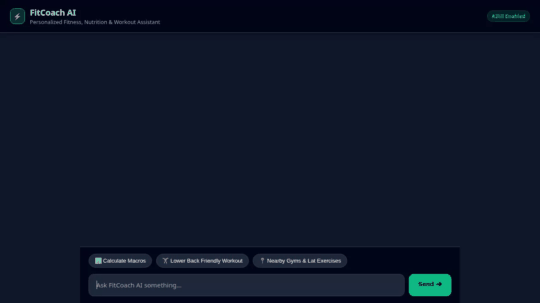

# FitCoach AI ⚡

FitCoach AI is an intelligent, personalized fitness, nutrition, and workout assistant built with Google Cloud Agent Development Kit (ADK) and deployed to Vertex AI Agent Engine with a custom A2UI-enabled web frontend.



---

## 🌟 Implemented Features & Architecture

FitCoach AI connects to Google Cloud services and external APIs to provide personalized fitness coaching, meal macro planning, and video demonstrations:

### 🧠 Persistent Long-Term Memory
- **Vertex AI Memory Bank**: Retains user preferences, workout history, goals, and injury constraints (e.g. lower back injuries) across multiple chat sessions via `VertexAiMemoryBankService` and `PreloadMemoryTool`.

### 🗄️ Database & Storage Integration
- **Google Cloud Firestore**: Persists exercise definitions and user workout logs (`add_exercise`, `get_exercise`, `list_exercises`, `log_user_workout`).
- **Google Cloud Storage (GCS)**: Stores generated workout card graphics and exercise demonstration videos in a public Cloud Storage bucket.

### 🎨 Multimodal Media Generation
- **Gemini Omni Video Generation (`gemini-omni-flash-preview`)**: Generates short video demonstrations of exercise techniques in real-time, attaches them to ADK Playroom artifacts, and uploads MP4 files to GCS.
- **Gemini Image Generation (`gemini-3.1-flash-lite-image`)**: Generates high-quality fitness illustrations and graphics.
- **Workout Card Graphic Generator**: Creates formatted visual workout card images with exercise metadata.

### 🖥️ A2UI (Agent-to-User Interface)
- **A2UI Schema Manager (v0.8)**: Generates structured declarative UI components (Cards, Columns, Rows, Text, Images) returned alongside plain-text replies.
- **Custom A2UI Frontend Renderer**: Light slate/emerald responsive web interface with custom card rendering and interactive quick-prompt chips.

### 📍 Location & External APIs
- **Google Maps Platform**: Geocodes user addresses and searches for nearby gyms, parks, and fitness centers (`geocode_address`, `find_nearby_places`).
- **Wger Exercise DB**: Queries public exercise definitions, target muscle groups, and equipment specs (`search_public_exercise_database`).
- **Fitness & Macro Calculator**: Computes target daily caloric splits (protein/carbs/fats) and heart rate training zones (`calculate_macros_and_zones`).
- **Agent Engine Sandbox**: Executes Python code in a secure sandboxed environment (`AgentEngineSandboxCodeExecutor`).

---

## 📋 Features Planned (Not Yet Implemented)

- **Wearable Health Sync**: Direct integration with Google Health Connect or Apple HealthKit APIs (*Planned*).
- **Barbell Bar Path Analysis**: Computer-vision posture scoring from user-uploaded videos (*Planned*).

---

## 🛠️ Project Structure

```text
fitcoach-ai/
├── app/
│   ├── agent.py                 # Core ADK Root Agent & Memory Bank wiring
│   ├── video_tool.py            # Gemini Omni video generation tool
│   ├── gemini_image_tool.py     # Gemini image generation tool
│   ├── firestore_tools.py       # Firestore exercise & workout log tools
│   ├── maps_tools.py            # Google Maps Geocoding & Places tools
│   ├── wger_tool.py             # Public Wger exercise database tool
│   ├── fitness_calculator.py    # Macro & HR zone calculation tool
│   └── a2ui_utils.py            # A2UI callback and schema utilities
├── frontend/
│   ├── main.py                  # FastAPI A2A proxy server
│   └── static/index.html        # Custom dark slate/emerald chat UI with A2UI renderer
├── agents-cli-manifest.yaml     # Agents CLI deployment manifest
├── demo.gif                     # Recorded demo walkthrough
└── requirements.txt             # Python dependencies
```

---

## 🚀 Local Setup & Running Instructions

### Prerequisites
- Python 3.10+
- Google Cloud SDK (`gcloud`) authenticated to your GCP project
- Google Maps API Key configured in your environment

### 1. Environment Setup

```bash
# Clone repository and create virtual environment
python3 -m venv .venv
source .venv/bin/activate

# Install dependencies
pip install -r requirements.txt
```

### 2. Set Environment Variables

```bash
export GOOGLE_CLOUD_PROJECT="<YOUR_PROJECT_ID>"
export GOOGLE_CLOUD_LOCATION="us-central1"
export GOOGLE_MAPS_API_KEY="<YOUR_GOOGLE_MAPS_API_KEY>"
```

### 3. Run ADK Web Playground (Local ADK Server)

```bash
adk web app --port 8080 --reload_agents
```

### 4. Run Custom Web Frontend (FastAPI Proxy + Chat UI)

In a separate terminal:

```bash
export AGENT_DIRECTORY="app"
export PORT=8085
python3 frontend/main.py
```

Open your local browser to the host and port printed by FastAPI (default `http://localhost:8085` or your assigned local port) to interact with FitCoach AI!
